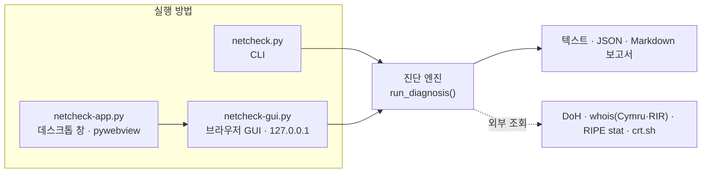
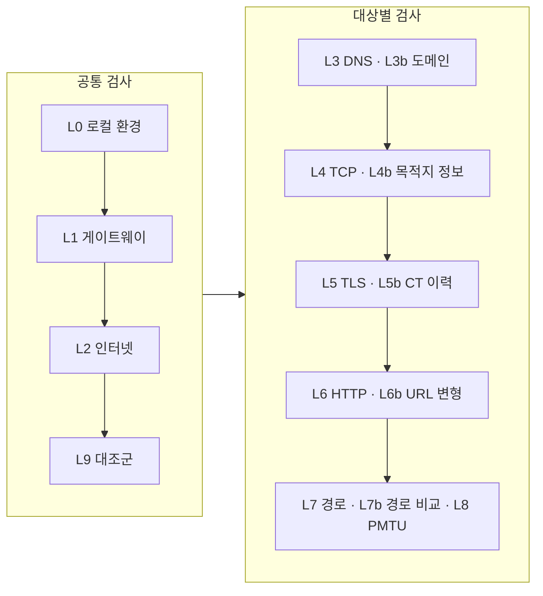

# netcheck

**계층별 네트워크 도달성 진단 도구** — 접속 실패를 계층(L0~L9)과 구간 단위로 검사해 실패 계층·원인 구간·조치를 출력한다.

- 로컬 환경부터 DNS·TCP·TLS·HTTP·경로까지 계층마다 독립된 방법으로 검사하고 정상 대조군과 비교
- **가장 얕은 계층의 치명적 실패**를 근본 원인으로 판정, 대상별로 분리
- CLI · 브라우저 GUI · 데스크톱 앱 (macOS · Linux · Windows)
- 진단 엔진은 Python 표준 라이브러리만 사용 (Python 3.8+)

```
요약
  ✘ 1.1.1.1                   L4 · 목적지 포트 정책 — 1.1.1.1:81 무응답(패킷 드롭). …
  ✘ nonexist.example.com      L3b · 도메인 — 주소 레코드 없음(NODATA). …
  ✔ www.weather.go.kr         문제 없음 — 전 계층 통과
```

---

## 구성



## 검사 계층



| 계층 | 확인 내용 |
|---|---|
| L0 · L1 | 기본 경로·공인 IP·NAT·VPN·프록시, 게이트웨이 손실 |
| L2 · L9 | DNS 없이 IP 로 인터넷 연결, 정상 대조군 연결 |
| L2b · L2c | 회선별 연결 비교, 직접 연결과 프록시 연결 비교 |
| L3 · L3b | 시스템 DNS·OS 해석기·공용 DNS·DoH 비교(싱크홀·조작·NXDOMAIN 주입·53번 가로채기), 도메인 등록·권위 서버 |
| L4 · L4b | TCP 실패 유형(드롭·RST·도달 불가·로컬 차단), IPv4/IPv6, MSS, TCP 홉 거리, 소유자·RPKI |
| L5 · L5b | TLS 핸드셰이크·인증서·SNI 차단, CT 로그 발급 이력(TLS 가로채기) |
| L6 · L6b | HTTP 응답·구간별 시간·리다이렉트·거절 본문, https·http × www 조합 비교 |
| L7 · L7b · L8 | 홉별 AS·손실·역방향, 정상 경로와 분기 지점, 경로 MTU |

---

## 빠른 시작

```bash
git clone https://github.com/zz1231me/netcheck.git
cd netcheck
```

**CLI**

```bash
python3 tools/netcheck.py www.example.com                 # 진단
python3 tools/netcheck.py -b api.example.com www.example.org   # 결론만, 여러 대상 비교
python3 tools/netcheck.py https://api.example.com/v1?x=1  # URL 그대로
python3 tools/netcheck.py --report report.md api.example.com   # 보고서 저장
```

**GUI**

```bash
python3 tools/netcheck-gui.py                             # 브라우저로 열림
```

**데스크톱 앱**

```bash
pip install -r tools/requirements-app.txt
python3 tools/netcheck-app.py                             # 네이티브 창
python3 tools/build-app.py                                # 실행 파일 생성 (dist/)
```

종료 코드: `0` 정상 · `1` 치명적 실패 · `2` 사용법 오류 · `3` 일부 검사 중단

---

## 문서

| 문서 | 내용 |
|---|---|
| [docs/usage.md](docs/usage.md) | 설치·CLI 옵션·출력 읽기·JSON·보고서·반복 관측·프록시·GUI·데스크톱 앱·빌드 |
| [docs/diagnosis.md](docs/diagnosis.md) | 진단 원리·계층별 수동 확인 방법·증상별 원인·사례·오판 방지 |

## 프로젝트 구조

```
netcheck/
├── tools/
│   ├── netcheck.py           진단 엔진 · CLI
│   ├── netcheck-gui.py       브라우저 GUI (로컬 서버)
│   ├── netcheck-app.py       데스크톱 앱 (pywebview)
│   ├── build-app.py          실행 파일 빌드 (PyInstaller)
│   ├── test_verdicts.py      판정 시험
│   └── requirements-app.txt  데스크톱 앱 의존성
├── docs/
│   ├── usage.md
│   └── diagnosis.md
└── .github/workflows/build-app.yml   Windows · macOS · Linux 빌드
```

## 시험

```bash
python3 tools/test_verdicts.py          # 가상 네트워크 시나리오로 판정 검증
```
