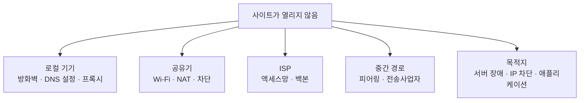
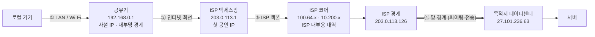
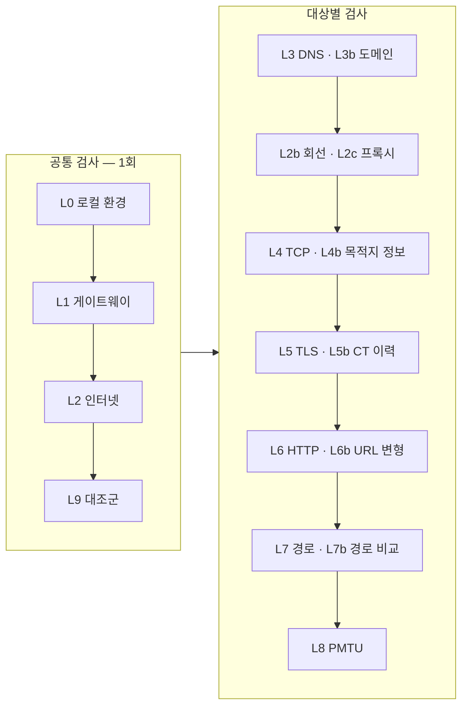
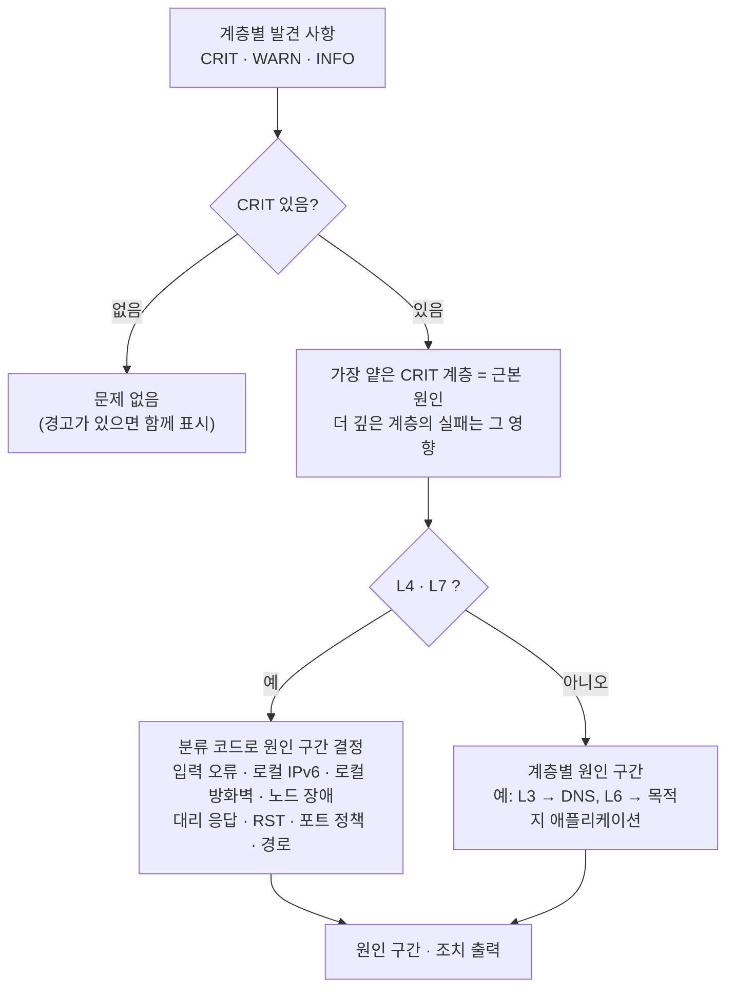

# 진단 원리 — 실패 구간과 책임 주체 확인

접속 실패를 계층과 구간 단위로 좁혀 원인 구간과 문의 대상을 정하는 방법. `netcheck` 가 수행하는 검사의 원리이며, 수동으로 확인할 때도 같은 순서를 따른다.

- 사용법은 [usage.md](usage.md)
- 예시 사례: 2026-09-05 공공데이터포털(`apis.data.go.kr`) 접속 실패 (§6)
- 명령 출력은 실제 실행 결과. 장애 재현이 어려운 항목(프록시 거부·TLS 가로채기·회선 대조 등)은 **출력 형식 예시**로 표시
- 사용자 회선 정보(사설 주소·ISP 경로·AS)는 문서용 예약 값(`192.168.0.x`, `203.0.113.x`, `198.51.100.x`, `AS64500`)으로 표기

## 목차

0. [확인 대상](#0-확인-대상)
1. [패킷 경로 구간](#1-패킷-경로-구간)
2. [IP 주소 형태로 구간 추정](#2-ip-주소-형태로-구간-추정)
3. [계층별 검사와 판정](#3-계층별-검사와-판정)
4. [계층별 수동 확인 방법](#4-계층별-수동-확인-방법)
5. [증상별 원인](#5-증상별-원인)
6. [사례 — 2026-09-05 공공데이터포털 접속 실패](#6-사례--2026-09-05-공공데이터포털-접속-실패)
7. [자주 하는 오해](#7-자주-하는-오해)
8. [오판 방지 교차 확인](#8-오판-방지-교차-확인)
9. [자동화되지 않는 항목](#9-자동화되지-않는-항목)
10. [용어](#10-용어)

---

## 0. 확인 대상



**기본 원리**
- 패킷이 마지막으로 응답한 지점을 찾으면 문제는 **그 다음 구간**에 있음
- 그 지점의 **소유자(AS)** 를 확인하면 책임 구간이 정해짐

---

## 1. 패킷 경로 구간



- 구간 구분 기준은 홉 번호가 아니라 **IP 소유자**
- 홉 번호는 경로에 따라 바뀌지만 소유자는 바뀌지 않음. 소유자 확인은 §4.6 `whois`, §4.10 AS 조회

---

## 2. IP 주소 형태로 구간 추정

| IP 형태 | 종류 | 예 |
|---|---|---|
| `10.x` / `172.16~31.x` / `192.168.x` | 사설 IP (RFC1918) | 공유기 `192.168.0.1` |
| `100.64~127.x` | CGNAT 대역 (RFC6598) | ISP 내부 `100.64.1.241` |
| `169.254.x` | 링크로컬 — DHCP 로 주소를 받지 못함 | |
| 그 외 | 공인 IP | `203.0.113.1` |

- ISP 내부에서도 사설 IP(`10.200.x`)가 나옴. **첫 공인 IP 이후의 사설 IP 는 ISP 내부 구간**
- 정확한 경계는 §4.6·§4.10 의 소유자 조회로 확인

---

## 3. 계층별 검사와 판정

`netcheck` 는 아래 순서로 검사하며 출력의 계층 이름(`L0`~`L9`)도 같다.



| 계층 | 이름 | 검사 내용 | 방법 |
|---|---|---|---|
| L0 | 로컬 환경 | 기본 경로·공인 IP·NAT·VPN·프록시 | route, ifconfig, scutil·레지스트리 |
| L1 | 게이트웨이 | 공유기까지 손실·지연 | ping |
| L2 | 인터넷 연결 | DNS 없이 IP 로 외부 연결 | TCP → 1.1.1.1 등 4곳 |
| L2b | 회선 대조 | 회선별 연결 결과 | 출발지 바인딩 |
| L2c | 프록시 대조 | 직접 연결과 프록시 연결 비교 | CONNECT · SOCKS |
| L3 | DNS | 시스템 DNS·OS 해석기·공용 DNS·DoH 응답 비교 | 직접 질의, DoH |
| L3b | 도메인 | 등록 상태·만료·권위 서버 응답 | whois, NS 질의 |
| L4 | TCP | 포트 연결, 실패 유형(드롭·RST·도달 불가·로컬 차단) | connect() + errno |
| L4b | 목적지 정보 | 소유자·대역·국가·abuse 연락처·RPKI | Cymru, RIR whois, PTR |
| L5 | TLS | 핸드셰이크·인증서·SNI | ssl |
| L5b | 인증서 이력 | CT 로그 등록 여부·발급자 이력 | crt.sh |
| L6 | HTTP | 응답 코드·구간별 시간·리다이렉트·거절 본문 | HTTP 요청 |
| L6b | URL 변형 | https·http × www 유무 조합의 응답 비교 | HTTP 요청 × 최대 4 |
| L7 | 경로 | 홉별 소유자·손실·역방향 홉 수 | traceroute, ping TTL |
| L7b | 경로 비교 | 정상 대조군 경로와의 분기 지점 | traceroute × 2 |
| L8 | PMTU | 큰 패킷 통과 여부 | ping DF |
| L9 | 대조군 | 정상이어야 할 목적지의 연결 여부 | TCP → 대조군 |

### 판정 흐름



- 공통 검사(L0·L1·L2·L9)의 실패는 모든 대상에 적용, 대상별 검사는 대상마다 따로 판정
- 예: L2 가 실패한 상태에서 L4 실패를 따로 분석할 필요 없음

**계층별 일반적 원인**

| 실패 계층 | 일반적 원인 | 확인 주체 |
|---|---|---|
| L0 · L1 | LAN·Wi-Fi·DHCP·VPN·프록시 설정 | 사용자 |
| L2 · L9 | 회선 전체 장애 | 통신사 |
| L2b | 특정 회선에서만 실패 | 해당 회선 통신사 |
| L2c | 프록시 거부·인증 요구 | 프록시 관리자 |
| L3 | DNS 서버 장애, 공유기·사내 DNS 차단·가로채기 | 사용자 또는 네트워크 정책 |
| L3b | 도메인 만료·정지·위임 오류·주소 레코드 없음 | 도메인 소유자 |
| L4 | 경로 장애, 방화벽 차단, 서비스 중지, 포트 차단, 주소 오류 | 경로·목적지·설정 (§4.9) |
| L4b | RPKI invalid (광고 AS 가 대역의 정당한 소유자가 아님) | 경로 출처 |
| L5 | 인증서 만료·불일치, SNI 차단, 중간 가로채기, TLS 버전 | 목적지 또는 중간 장비 |
| L5b | 인증서가 CT 이력과 불일치 | 가로채기 장비 (로컬 기기·내부망) |
| L6 | 서버 오류, 인증 실패, 호출 한도 초과 | 목적지 애플리케이션 |
| L6b | (경고만) 입력 주소는 실패, 다른 조합은 응답 | 주소 선택·DNS·서버 설정 |
| L7 | 특정 구간 중단 | 해당 구간 소유자 |
| L8 | 경로 MTU 축소 | 공유기 또는 경로 |

- **API 키 차단은 L6(HTTP 응답)에서 나타남.** L4 에서 실패하면 키와 무관

---

## 4. 계층별 수동 확인 방법

### 4.1 게이트웨이 주소 확인

```bash
route -n get default
```

```
      gateway: 192.168.0.1
    interface: en0
```

- `gateway` 가 공유기 주소. traceroute 1번 홉이 이 주소여야 정상
- 다르면 VPN·가상 인터페이스 경유

macOS 인터페이스 순서·상태:

```bash
networksetup -listnetworkserviceorder | head -20
scutil --nwi
```

### 4.2 DNS — 이름 해석

```bash
dig +short apis.data.go.kr
```

시스템 DNS 와 공용 DNS 응답 비교:

```bash
for h in apis.data.go.kr www.data.go.kr; do
  echo "$h  시스템=$(dig +short $h | tail -1)  cloudflare=$(dig +short $h @1.1.1.1 | tail -1)  google=$(dig +short $h @8.8.8.8 | tail -1)"
done
```

```
apis.data.go.kr  시스템=27.101.236.63  cloudflare=27.101.236.63  google=27.101.236.63
www.data.go.kr   시스템=27.101.236.55  cloudflare=27.101.236.55  google=27.101.236.55
```

- 시스템 응답만 다르면 공유기·ISP 의 DNS 변경
- 셋이 같아도 53번 포트 가로채기는 배제되지 않음 → §4.8 DoH 로 확인

현재 DNS 서버:

```bash
scutil --dns | grep 'nameserver\[0\]' | sort -u
```

### 4.3 TCP — 포트 연결

```bash
nc -z -G 3 ws.bus.go.kr 80 && echo 열림 || echo 막힘
```

```
Connection to ws.bus.go.kr port 80 [tcp/http] succeeded!
```

- `-G 3`: 연결 타임아웃 3초 (macOS)
- TCP 실패 시 TLS·HTTP 검사는 의미 없음

포트별 비교로 호스트 중지와 포트 차단을 구분:

```bash
for p in 80 443; do nc -z -G 3 www.data.go.kr $p && echo "$p 열림" || echo "$p 막힘"; done
```

- 모두 실패: 호스트 또는 경로 문제
- 443 만 실패: 포트 단위 차단(방화벽 정책) 의심
- `nc` 는 실패 유형을 구분하지 않음 → §4.9

### 4.4 단계별 소요 시간 — `curl`

```bash
curl -sS -m 8 -o /dev/null \
  -w "dns=%{time_namelookup}s connect=%{time_connect}s tls=%{time_appconnect}s ttfb=%{time_starttransfer}s total=%{time_total}s code=%{http_code}\n" \
  https://www.weather.go.kr
```

```
dns=0.025680s connect=0.032032s tls=0.044123s ttfb=0.051523s total=0.051563s code=302
```

값은 **누적 시간**. 단계별 시간은 앞 값과의 차이.

| 값 | 의미 | 이 예 |
|---|---|---|
| `time_namelookup` | DNS 완료 | 0.026s |
| `time_connect` | TCP 완료 (누적) | 0.032s → TCP 0.006s |
| `time_appconnect` | TLS 완료 (누적) | 0.044s → TLS 0.012s |
| `time_starttransfer` | 첫 바이트 (누적) | 0.052s → 서버 처리 0.008s |

- `connect` 에서 멈춤 → 경로·방화벽
- `appconnect` 에서 멈춤 → TLS·인증서
- `starttransfer` 만 큼 → 서버 처리 지연. 네트워크 정상
- 실패하면 이후 값이 모두 `0`. **0 은 "빠름"이 아니라 "해당 단계에 도달하지 못함"**

```
$ curl ... https://apis.data.go.kr
curl: (28) Connection timed out after 8004 milliseconds
  dns=0.004154 connect=0.000000 tls=0.000000 ttfb=0.000000 code=000
       ^^^^^^^^ DNS 완료    ^^^^^^^^ TCP 단계에서 실패
```

정상 응답은 단계마다 값이 증가함:

```
  dns=0.003056 connect=0.009945 tls=0.022241 ttfb=0.032722 code=302
```

### 4.4b URL 변형 비교 — https·http·www 조합

입력한 주소 하나만 확인하면 "www 를 붙이면 되는데 안 붙여서 실패" 같은 경우를 놓친다. 조합을 모두 요청해 비교한다.

```bash
for u in https://data.go.kr https://www.data.go.kr http://data.go.kr http://www.data.go.kr; do
  curl -s -o /dev/null -m 8 -w "$u  %{http_code}  %{redirect_url}\n" "$u"; done
```

`netcheck.py` 의 **L6b** 출력 (2026-10-18 실행):

```
L6b · URL 변형 — https·http·www 조합 응답
  ✔ https://data.go.kr  (입력) 301 → 200  289ms  → https://www.data.go.kr/
  ✔ https://www.data.go.kr 200  211ms
  ✘ http://data.go.kr 301 → 301  63ms  → http://www.data.go.kr/  (이동 실패: 같은 주소로 반복 이동 — 서버 리다이렉트 설정 오류)
  ✘ http://www.data.go.kr 301  42ms  (이동 실패: 같은 주소로 반복 이동 — 서버 리다이렉트 설정 오류)
```

- `http://www.data.go.kr/` 가 자기 자신으로 301 이동을 반복 (curl 로도 동일) — 서버 설정 오류. HTTPS 로 접속하면 정상

| 관측 | 의미 |
|---|---|
| www 없는 주소만 실패 | 도메인 자체(apex)의 A 레코드·서버 설정 누락. www 주소 사용 |
| HTTPS 만 실패 | 443 미지원 또는 차단 |
| HTTP 만 실패 | 80 미지원·차단 또는 리다이렉트 오류 |
| HTTP 가 HTTPS 로 이동하지 않음 | 평문 접속 허용 (참고) |

### 4.5 traceroute — 도달 구간

```bash
traceroute -n -w 1 -q 1 -m 15 27.101.236.63
```

| 옵션 | 의미 | 비고 |
|---|---|---|
| `-n` | 역방향 이름 조회 안 함 | 속도 향상 |
| `-w 1` | 응답 대기 1초 | 기본 5초 |
| `-q 1` | 홉당 프로브 1회 | 기본 3회 |
| `-m 15` | 최대 15홉 | |
| `-I` | ICMP 사용 | 기본은 UDP. sudo 불필요 |
| `-P TCP -p 443` | TCP 사용 | sudo 필요 (없으면 `pcap_activate() failed`) |

UDP 응답이 없으면 ICMP:

```bash
traceroute -n -I -w 1 -q 1 -m 15 27.101.236.63
```

UDP·ICMP 모두 차단된 경우 TCP (권한 필요):

```bash
sudo traceroute -n -P TCP -p 443 -w 1 -q 1 -m 15 27.101.236.63
```

권한 없이 TCP 홉 거리만 재는 방법은 §4.21.

### 4.6 whois — 홉 소유자 확인

```bash
whois 203.0.113.126 | grep -iE "^(orgname|org-name|netname|descr|organization)" | head -3
```

2026-09-05 확인 결과:

```
203.0.113.1   → netname: EXAMPLE-ISP-NET   descr: Example ISP
203.0.113.126    → netname: EXAMPLE-ISP-NET   descr: Example ISP
27.101.236.63   → netname: NIRS        descr: NATIONAL INFORMATION RESOURCES SERVICE
139.150.249.139 → NetName: APNIC-ERX-139-150-0-0
```

- 2~8번 홉이 모두 Example ISP → 마지막 응답 지점은 ISP 내부
- 중단 지점은 ISP 에서 목적지 망으로 넘어가는 구간 또는 그 이후

경로 전체 일괄 조회:

```bash
traceroute -n -w 1 -q 1 -m 15 <목적지> 2>/dev/null \
| awk '{print $2}' | grep -E '^[0-9]+\.' \
| while read ip; do
    printf "%-16s %s\n" "$ip" "$(whois $ip 2>/dev/null | grep -im1 -E '^(orgname|descr|netname)')"
  done
```

### 4.7 ICMP — ping

```bash
ping -c 3 -W 2000 27.101.236.63
```

```
Request timeout for icmp_seq 1
3 packets transmitted, 0 packets received, 100.0% packet loss
```

- ICMP 를 차단하는 서버가 많음. **ping 실패만으로 서버 중지로 판정하지 않음**
- 반드시 §4.3 TCP 결과와 함께 확인

### 4.8 DoH — DNS 응답 대조

- `@1.1.1.1` 질의도 53번 포트를 지나므로 공유기·ISP 가 가로채 다른 응답을 줄 수 있음
- 이 경우 시스템·공용 DNS 응답이 모두 같게 나와 조작 여부를 확인할 수 없음
- DNS 질의를 HTTPS 안에 넣는 DoH 로 비교
- DoH 서버 이름 해석도 조작될 수 있으므로 **IP 로 직접 접속** (`--resolve`)

```bash
curl -s --resolve cloudflare-dns.com:443:1.1.1.1 \
  -H 'accept: application/dns-json' \
  'https://cloudflare-dns.com/dns-query?name=www.google.com&type=A' | jq -r '.Answer[].data'
```

이 맥에서의 결과:

```
$ dig +short www.google.com                  ← 평문 DNS
forcesafesearch.google.com.
216.239.38.120

$ curl ... (위 DoH 명령)                      ← DoH
142.251.150.119
142.251.151.119
...
```

- 이 네트워크는 평문 DNS 를 SafeSearch 주소로 변경함
- `@1.1.1.1`, `@8.8.8.8` 질의도 같은 결과 → DNS 서버 변경으로 해결되지 않는 투명 가로채기
- 같은 네트워크에서 `cloudflare-dns.com` 은 `0.0.0.0` 으로 응답 (DoH 서버 이름 차단). IP 직접 접속이 필요한 이유

CDN·GSLB 는 질의 위치에 따라 다른 IP 를 주므로 IP 가 아니라 **소유 AS** 로 비교 (§4.10).

| 시스템 응답 | DoH 응답 | 판정 |
|---|---|---|
| 같음 | 같음 | 조작 없음 |
| 다름, 같은 AS | | CDN/GSLB. 정상 |
| 다름, 다른 AS | | DNS 응답 조작 |
| `0.0.0.0`·`127.0.0.1` | 정상 IP | 싱크홀 (DNS 차단) |
| CNAME 이 `forcesafesearch`·`block`·`warning` 류 | | 네트워크 필터링 정책 |
| NXDOMAIN | 정상 IP | NXDOMAIN 주입 (DNS 차단) |
| 주소 레코드 없음 | 주소 레코드 없음 | 도메인 DNS 레코드 설정 문제 (NODATA) |

### 4.9 TCP 실패 유형

`nc` 는 성공/실패만 알려 줌. 실패 유형에 따라 차단 주체가 다름.

| 수신한 것 | errno | 의미 | 차단 주체 |
|---|---|---|---|
| 없음 | `ETIMEDOUT` | 패킷 드롭 | 방화벽 DROP·널 라우팅·경로 단절 |
| RST | `ECONNREFUSED` | 호스트 응답, 포트 닫힘 | 목적지 서버 (서비스 미동작) |
| ICMP unreachable | `EHOSTUNREACH`/`ENETUNREACH` | 라우터가 경로 없음 응답 | 라우팅 |
| 연결 직후 RST | `ECONNRESET` | 중간 장비 개입 | 검열·IPS 장비 |

- **RST 수신 = 패킷이 목적지에 도달함.** 경로 문제에서 제외
- 무응답은 목적지 도달 여부를 알 수 없음
- 대상 포트가 무응답이어도 다른 포트가 연결되거나 RST 를 주면 호스트는 동작 중 → 포트 단위 차단

셸에서 확인:

```bash
python3 -c '
import socket,sys,errno
s=socket.socket(); s.settimeout(4)
try: s.connect((sys.argv[1],int(sys.argv[2]))); print("OPEN")
except socket.timeout: print("TIMEOUT — 패킷 드롭")
except OSError as e: print(errno.errorcode.get(e.errno), e.strerror)
' apis.data.go.kr 443
```

`netcheck.py` 는 이 구분과 대체 포트 확인을 자동으로 하고, `-r` 반복 측정으로 간헐 장애(`2/5 성공`)도 표시한다.

```
L4 · TCP 81 — 3-way handshake  (1회)
  ✘ 1.1.1.1          0/1  무응답 — 패킷 드롭  AS13335 Cloudflare, Inc.
  ⚠   ↳ :443         열림 — 호스트 동작 중, 대상 포트만 차단
  ⚠   ↳ :80          열림 — 호스트 동작 중, 대상 포트만 차단
```

### 4.10 AS — 망 경계 확인

whois 는 응답 형식이 기관마다 다름. **Team Cymru** 는 IP 를 AS 번호로 바로 변환함.

```bash
whois -h whois.cymru.com " -v 1.1.1.1"
```

```
AS    | IP      | BGP Prefix | CC | Registry | Allocated  | AS Name
13335 | 1.1.1.1 | 1.1.1.0/24 | US | arin     | 2010-07-14 | CLOUDFLARENET, US
```

- **AS 번호가 바뀌는 지점이 망 경계**
- AS 가 **`NA`**: 전역 BGP 에 광고되지 않는 주소. 차단이 아니라 도달 경로 자체가 없음 → DNS 응답·설정 주소 확인. 통신사 문의 대상 아님
- whois 조회 자체가 실패한 경우는 `NA` 와 구분해야 함 (조회 실패 ≠ 미광고)

### 4.11 TLS — 인증서와 SNI

TCP 성공 후 TLS 에서 실패하는 경우:

```bash
echo Q | openssl s_client -connect apis.data.go.kr:443 -servername apis.data.go.kr 2>&1 \
  | grep -E 'Protocol|Cipher|Verify return|^subject=|^issuer='
```

- **인증서 만료·이름 불일치** — `openssl x509 -checkend 0`, `-checkhost <이름>`
- **발급자가 공개 CA 가 아님** — 방화벽·백신의 TLS 검사 의심 (확인 방법은 §4.19)
- **SNI 차단** — 아래로 확인

```bash
# SNI 포함 → 실패
echo Q | openssl s_client -connect <ip>:443 -servername blocked.example.com
# SNI 제외 → 성공
echo Q | openssl s_client -connect <ip>:443 -noservername
```

- SNI 제외 시에만 성공 → 중간 장비가 ClientHello 의 호스트명으로 연결을 끊음. 서버는 정상

### 4.12 PMTU — 연결 후 큰 응답에서 멈춤

- 핸드셰이크는 성공하고 큰 응답에서 멈추면 경로 MTU 문제 의심
- 큰 패킷이 드롭되고 ICMP Fragmentation Needed 가 오지 않으면 연결은 유지되고 전송만 멈춤 (PMTU 블랙홀)

```bash
# DF 설정, 1472바이트 → +28 = 1500
ping -c 1 -D -s 1472 <목적지>          # macOS
ping -c 1 -M do -s 1472 <목적지>       # Linux
ping -n 1 -f -l 1472 <목적지>          # Windows
```

- 1472 실패, 1400 통과 → 경로 MTU 축소
- 공유기 MTU 를 1400 으로 낮춰 재현 여부 확인
- ICMP 가 차단된 경로는 이 방법으로 판정 불가 → §4.22 MSS

### 4.13 목적지 정보 — IP 로 확인할 수 있는 항목

- 목적지가 대형 CDN 이면 "특정 IP 만 차단" 가능성은 낮고, 자체 운영 단일 서버면 그 반대
- 확인 항목과 명령:

```bash
# ① AS·대역·국가·등록기관·할당일
whois -h whois.cymru.com " -v 27.101.236.63"
#   17841 | 27.101.236.63 | 27.101.236.0/24 | KR | apnic | 2010-05-25 | NCIA-AS-KR-KR - NIRS, KR

# ② 사용 주체·abuse 연락처 (RIR 등록 정보)
whois 27.101.236.63 | grep -iE '^(netname|descr|country|inetnum|abuse-mailbox)'

# ③ 역방향 이름 (PTR)
dig +short -x 27.101.236.63

# ④ 정방향 재확인 (FCrDNS)
dig +short "$(dig +short -x 1.1.1.1 | sed 's/\.$//')"

# ⑤ 인증서의 이름 목록 (SAN)
echo Q | openssl s_client -connect 1.1.1.1:443 2>/dev/null \
  | openssl x509 -noout -ext subjectAltName

# ⑥ 열린 포트
for p in 22 80 443 3306 8080; do nc -z -G 2 1.1.1.1 $p && echo "$p 열림"; done
```

`netcheck.py` 의 **L4b** 출력 (2026-10-18 실행):

```
L4b · 목적지 정보 — IP 소유자·대역
  · 주소             1.1.1.1  (공인)
  ✔ 역방향 이름      one.one.one.one  (정방향 조회 일치)
  · AS               AS13335  Cloudflare, Inc.
  · BGP 대역         1.1.1.0/24  (국가 AU, 등록 apnic, 할당 2011-08-11)
  · 등록 대역명      APNIC-LABS   (1.1.1.0 - 1.1.1.255)
  · 사용 주체        APNIC Research and Development  [AU]
  · 신고처           helpdesk@apnic.net
  ✔ 경로 출처(RPKI)  valid — AS13335 가 1.1.1.0/24 의 정당한 광고자
  · 성격             CDN — Cloudflare
```

| 항목 | 용도 |
|---|---|
| 역방향 이름 + 정방향 재확인 | PTR 은 임의 설정 가능. 정방향 조회가 일치할 때만 신뢰 |
| AS·BGP 대역 | 책임 주체. 경로의 마지막 응답 홉과 같은 AS 면 목적지 네트워크 내부에서 중단 |
| 국가·등록기관·할당일 | 국가가 예상과 다르면 CDN 엣지 또는 DNS 응답 오류 |
| 등록 대역명·사용 주체 | BGP 광고 주체와 RIR 등록 주체는 다를 수 있음 |
| 신고처 | 차단·남용 문의 연락처 |
| 성격 | CDN·클라우드·공공망·자체 운영 구분 (AS·조직 이름 기반 참고값) |
| 열린 포트 (`-f`) | 여러 포트가 열려 있으면 호스트 동작 중. 전부 RST 면 호스트 동작, 서비스 없음 |
| RPKI | §4.23 |

주소만으로 판정되는 경우:

| 관측 | 의미 |
|---|---|
| `192.0.2.x` `198.51.100.x` `203.0.113.x` | 문서용(RFC5737). 실제 서비스 주소 아님 |
| `198.18~19.x` | 벤치마크용(RFC2544) |
| `240.x` 이상 | 예약 대역 |
| AS `NA` | BGP 미광고 주소 |

- 위 경우는 네트워크가 아니라 **주소·설정 오류**. 통신사 문의 대상 아님

### 4.14 AS 단위 경로 요약

홉 단위가 아니라 소유자가 바뀌는 지점 위주로 본다. `netcheck.py` 의 **L7** 출력 (2026-10-18 실행):

```
    홉  주소                 RTT    증가   응답  AS        소유자
  ✔ 1   192.168.0.1           3.296           2/2  -         사설(RFC1918)
  ✔ 2   203.0.113.9          3.779   +0.5    2/2  AS64500    Example ISP
  ✔ 3   100.64.1.101      7.813   +4.0    1/2  -         CGNAT(RFC6598)
  ...
  ✔ 8   203.0.113.58       4.577   -1.1    2/2  AS64500    Example ISP
  ⚠ 9   198.51.100.13        5.243   +0.7    2/2  AS64501    Example Transit ECMP   ← AS 경계
  ✔ 11  198.51.100.162      5.477   +0.5    2/2  AS64501    Example Transit ECMP
  ⚠ 12  141.101.82.21       4.966   -0.5    2/2  AS13335   Cloudflare, Inc. ECMP ← AS 경계
  ✔ 13  1.1.1.1             5.042   +0.1    2/2  AS13335   Cloudflare, Inc.
        ↳ one.one.one.one

  · AS 경로   [로컬] → AS64500 Example ISP (2~8홉) → AS64501 Example Transit (9~11홉)
              → AS13335 Cloudflare, Inc. (12~13홉)
```

- **AS 경로 한 줄**로 중단 지점의 책임 주체를 바로 확인
- `증가` 열: 앞 홉 대비 RTT 차이. 라우터의 ICMP 처리 지연 차이로 **음수도 정상 범위**. 큰 증가 구간만 의미 있음 (대개 망 경계)
- `↳`: 역방향 이름. 라우터 PTR 에는 도시·회선 정보가 들어 있는 경우가 있음 (국내 ISP 는 없는 경우가 많음)

### 4.15 회선별 대조

기기에 회선이 둘 이상이면(휴대폰 테더링, 유선+무선) 출발지 주소를 고정해 회선별로 측정할 수 있다.

```bash
ifconfig | awk '/^[a-z]/{i=$1} /inet /&&$2!~/^127/{print i, $2}'
#   en0  192.168.0.10        ← Wi-Fi
#   en7  172.20.10.5       ← 아이폰 테더링

curl --interface 172.20.10.5 -sS -m 5 -o /dev/null -w '%{http_code}\n' https://대상/
```

Python:

```python
s = socket.socket(); s.bind(("172.20.10.5", 0)); s.connect(("대상", 443))
```

`netcheck.py` 는 회선이 둘 이상이면 **L2b** 를 자동 실행한다 (출력 형식 예시):

```
L2b · 회선 대조 — 회선별 연결
  ✘ en0              192.168.0.10 → 27.101.236.63:443  무응답 — 패킷 드롭
  ✔ en7              172.20.10.5 → 27.101.236.63:443  열림  43ms
```

| 관측 | 판정 |
|---|---|
| 한쪽 회선만 실패 | 실패한 회선의 통신사 경로 문제. 목적지는 정상 |
| 모든 회선 실패 | 목적지 또는 공통 경로 문제. 특정 회선 문제 아님 |
| 모든 회선 성공 | 현재 정상. 간헐 장애면 `--watch` 로 반복 관측 |

- Linux 는 출발지 바인딩과 무관하게 목적지 기준으로 경로를 고르므로, 실제 출력 인터페이스가 다르면 해당 회선은 측정에서 제외함 (`ip route get` 으로 확인)

### 4.16 홉별 손실률 해석

홉마다 프로브를 여러 번 보내면 손실률이 나온다 (`mtr` 과 같은 방식).

```bash
traceroute -n -q 5 -w 1 -m 15 <목적지>
```

```
  ✔ 8   203.0.113.62      5.117   -0.2   5/5  AS64500  Example ISP
  ⚠ 9   198.51.100.25       4.878   -0.2   2/5  AS64501  Example Transit
  ✔ 10  198.51.100.30       4.724   -0.2   5/5  AS64501  Example Transit
```

- 9번 홉 손실 + 10번 홉 정상 → 패킷은 9번을 통과함. 9번 라우터의 **ICMP 응답 제한**
- 라우터는 ICMP 응답 생성을 낮은 우선순위로 처리하거나 개수를 제한함
- **경로 손실은 마지막 홉(목적지)까지 손실이 이어질 때만 판정**
- 경로가 목적지에 도달하지 않은 경우 마지막 응답 홉의 손실로는 판정하지 않음

`netcheck.py` 표시:

```
  · 중간 손실        있음 — 마지막 홉 2/2, ICMP 응답 제한 (경로 손실 아님)
  ✘ 경로 손실        마지막 홉 3/5 — 경로상 패킷 손실
```

- 같은 홉에 여러 IP 가 나오면 `ECMP` (다중 경로). 한 경로만 장애면 간헐적 증상

### 4.17 역방향 경로

- traceroute 는 정방향 경로만 측정. 역방향 경로는 다를 수 있고 장애가 역방향에 있을 수 있음
- 역방향 홉 수는 응답 TTL 로 추정 가능

```bash
ping -c 1 1.1.1.1 | grep ttl
#   64 bytes from 1.1.1.1: icmp_seq=0 ttl=55 time=4.7 ms
```

- 초기 TTL 은 보통 64·128·255. `55` 수신 → 초기값 `64`, 역방향 `64 - 55 = 9` 홉

`netcheck.py` 출력 (2026-10-18 실행):

```
  · AS 경로          [로컬] → AS64500 Example ISP (2~8홉) → AS64501 Example Transit (9~11홉) → AS13335 Cloudflare, Inc. (12~13홉)
  ⚠ 역경로           역방향 9홉, 정방향 13홉 — 비대칭 경로
      역방향 경로 장애는 traceroute 로 확인 불가
```

- 비대칭 경로에서 "traceroute 는 정상인데 접속 실패" 이면 역방향 구간 문제일 수 있음
- 역방향 확인 방법: 목적지 측에서 반대 방향 traceroute, 또는 목적지 망의 공개 looking glass

### 4.18 프록시

- 앱이 프록시를 쓰고 진단 도구가 직접 연결하면 서로 다른 경로를 측정함
- **앱에서만 실패하고 도구로는 정상이면 프록시 설정을 먼저 확인**

```bash
scutil --proxy | grep -E 'Enable|Proxy|Port'   # macOS 시스템 설정
env | grep -i proxy                            # 환경변수
```

#### 프록시 경유 검사

```bash
./tools/netcheck.py --proxy http://proxy.corp:3128 api.example.com
./tools/netcheck.py --proxy socks5h://127.0.0.1:1080 api.example.com
./tools/netcheck.py --proxy-system api.example.com     # 시스템·환경변수 설정 사용
```

프록시를 지정하면 **L2c** 에서 직접 연결과 프록시 연결을 비교한다 (출력 형식 예시):

```
L2c · 프록시 대조 — 직접 연결 vs 프록시
  ✔ 직접             8.8.8.8:443  연결됨
  ✘ 프록시           http://proxy.corp:3128  프록시 거부 CONNECT 거부 403 Blocked by corporate policy
```

| 관측 | 판정 |
|---|---|
| 직접 ✘, 프록시 ✔ | 직접 나가는 트래픽 차단. 이 네트워크는 프록시 경유 필요 |
| 직접 ✔, 프록시 ✘ | 프록시 측 문제. 목적지는 정상 |
| 프록시 거부 | 프록시 정책. 거부 사유 기준으로 정책·인증·허용목록 확인 |
| 모두 ✔ | 프록시는 원인 아님 |

프록시 응답별 의미:

| 응답 | 의미 |
|---|---|
| `407 Proxy Authentication Required` | 자격증명 없음 또는 오류 |
| `403` + 차단 문구 | 정책상 목적지 금지 |
| `502` / `SOCKS5 거부: 호스트 도달 불가` | 프록시가 목적지에 연결 실패 — 프록시 이후 경로 문제 |

#### `socks5` 와 `socks5h`

| 방식 | 이름 해석 | 비고 |
|---|---|---|
| `socks5://` | 로컬에서 해석 후 IP 전달 | 로컬 DNS 사용 |
| `socks5h://` | 프록시에서 해석 | 로컬 DNS 차단·가로채기와 무관 |
| `http://` (CONNECT) | 프록시에서 해석 | 대부분의 사내 프록시 |

- 로컬 DNS 가 싱크홀을 반환할 때 `socks5h` 로 검사하면 DNS 차단과 목적지 차단을 구분할 수 있음 (출력 형식 예시):

```
  ✘ 직접             0.0.0.0 — 싱크홀 주소라 직접 연결 측정 생략
  ✔ 프록시(이름 전달) socks5h://…  연결됨
  ✘ L3   로컬 DNS 는 싱크홀 주소를 반환하지만 프록시 이름 해석으로는 접속됨 — DNS 차단 확인. 프록시로 우회 가능.
```

#### 프록시 환경의 한계

- `traceroute`·`ping` 은 프록시를 경유할 수 없음 (ICMP·UDP 는 CONNECT 터널로 전달되지 않음)
- 프록시 환경에서 L7 경로는 **직접 연결 경로**이며 실제 트래픽 경로가 아님
- 프록시 이후 경로는 프록시 서버에서 측정 필요

### 4.19 CT 로그 — 인증서 발급 기록 대조

- 발급자 이름만으로 가로채기를 판단하면 근거가 약함 (장비가 발급자 이름을 임의로 지정 가능)
- 공개 신뢰 인증서는 **Certificate Transparency(CT) 로그**에 등록됨 (브라우저 요구사항)
- [crt.sh](https://crt.sh) 로 등록 여부와 발급 이력 조회

```bash
# 도메인의 발급 이력 (발급자 목록)
curl -s 'https://crt.sh/?q=%25.example.com&output=json' | jq -r '.[].issuer_name' | sort -u

# 받은 인증서를 일련번호로 조회 (대문자 16진수)
SER=$(echo | openssl s_client -connect example.com:443 -servername example.com 2>/dev/null \
      | openssl x509 -noout -serial | cut -d= -f2)
curl -s "https://crt.sh/?serial=$SER&output=json" | jq length
```

`netcheck.py --ct` (또는 `-f`) 의 **L5b** 출력 형식:

```
L5b · 인증서 이력 — 공개 CT 로그(crt.sh) 대조
  ✔ 현재 인증서      CT 로그 등록 확인 (crt.sh id=29245502773)
  · 발급 이력        22건, 최근 2026-09-04
  · 발급자 이력      DigiCert SHA2 Secure Server CA, RapidSSL TLS RSA CA G1, Sectigo…  (3곳)
  · 로그에 남은 이름 weather.go.kr www.weather.go.kr
```

#### CT 미등록만으로 가로채기로 판정하지 않음

| 미등록 사유 | 판정 |
|---|---|
| 최근 발급 | crt.sh 색인 지연. 정상 |
| 자체 서명 | CT 등록 대상 아님. 내부용이면 정상 |
| 사설 CA | 사내 인증서 |
| crt.sh 조회 실패 | 판정 불가 (조회 실패 ≠ 미등록) |
| TLS 가로채기 | 중간 장비가 재서명 |

도구는 세 가지를 함께 확인한다.

1. **주체 = 발급자** → 자체 서명. CT 판정에서 제외
2. **주요 공개 CA 발급** → 색인 지연으로 처리
3. **이 도메인의 CT 발급자 이력에 있는 발급자인지** → 이력에 없고 공개 CA 도 아니면 가로채기 의심

출력 형식 예시:

```
# ① 공개 CA 발급, 미색인 — 경고 없음
  · 현재 인증서      CT 미확인 — 발급자는 공개 CA. 색인 지연 가능
      발급일 Sep  1 — 최근 발급이면 미색인 상태일 수 있음

# ② 사내 CA 재서명 — CRIT
  ✘ 현재 인증서      CT 미등록, 이력에 없는 발급자
  ⚠ 발급자 변경      현재 발급자 'acme corp tls inspection ca' 이력에 없음
  ✘ L5b  인증서 발급자(acme corp tls inspection ca)가 CT 이력에 없고 인증서도 CT 미등록 — TLS 가로채기(중간 재서명) 의심.
```

#### 추가로 확인되는 정보

- **로그에 남은 이름**: 인증서가 발급된 서브도메인 목록 (개발·내부 호스트 포함)
- **발급자 이력**: 사용 중인 CA 와 변경 시점
- **발급 시점**: 갱신 주기, 최근 발급 (7일 이내면 표시)

> **주의**
> - 조회 시 crt.sh(제3자)에 도메인 이름이 전송됨. 사내 전용 도메인이면 주의
> - 공개 CA 로 발급한 인증서의 서브도메인 이름은 CT 로그로 공개됨

### 4.20 IPv4·IPv6 동시 확인

- 앱은 두 스택을 함께 시도함 (Happy Eyeballs)
- 한쪽만 장애면 완전 실패가 아니라 **간헐적 지연·실패**로 나타남
- IPv4 만 측정하는 도구로는 확인되지 않음

```bash
for f in -4 -6; do curl $f -sS -m 5 -o /dev/null -w "$f %{http_code} %{time_total}\n" https://대상/; done
```

`netcheck.py` 는 `-4`/`-6` 미지정 시 두 스택을 모두 측정한다 (2026-10-18 실행):

```
L4 · TCP 443 — 3-way handshake  (1회)
  ✔ 216.239.38.120   1/1 성공  39ms (39–39)  AS15169 Google LLC
  ✘ IPv6             2001:4860:4802:32::78  ICMP 도달 불가 — 라우터가 경로 없음 응답
      앱에서만 문제가 생기는 경우 이 항목 확인
```

| 관측 | 의미 |
|---|---|
| IPv4 ✔ · IPv6 ✘ | 앱이 IPv6 를 먼저 시도한 뒤 IPv4 로 전환 → 간헐적 지연 원인 |
| IPv4 ✘ · IPv6 ✔ | IPv4 경로 문제. IPv6 로 우회 가능 |
| AAAA 없음 | IPv4 전용 목적지. 정상 |
| 로컬 IPv6 경로 없음 | 앱도 IPv4 만 사용. IPv6 측정 생략, 경고 없음 |
| IPv6 주소를 대상으로 지정 + 로컬 IPv6 경로 없음 | 로컬 회선의 IPv6 미지원 (L4, 목적지 문제 아님) |

### 4.21 TCP 홉 거리 측정

- ICMP·UDP traceroute 가 모두 차단된 네트워크에서도 TCP SYN 의 TTL 을 바꿔 홉 거리를 잴 수 있음 (root 불필요)

```python
s = socket.socket(); s.setsockopt(socket.IPPROTO_IP, socket.IP_TTL, 5)
s.connect((대상, 443))     # 성공하면 5홉 이내
```

- 연결이 성립하는 최소 TTL 이 거리
- 중간 라우터가 버린 SYN 은 ICMP 로 바로 돌아오므로 측정이 빠름 (13홉 기준 약 0.05초)

**① traceroute 차단 시 거리 확인**

```
  ✘ traceroute       전 홉 무응답 — ICMP/UDP 차단된 네트워크
  ✔ TCP 거리         11홉 (TCP SYN TTL 측정)
      홉 주소는 알 수 없음. 거리 비교용
```

**② 중간 장비의 대리 응답 확인**

- 경로상 목적지가 12홉인데 TCP 가 3홉에서 연결되면 응답 주체는 목적지가 아님 (투명 프록시·캐시·검열 장비)

```
  ✘ 중간 응답        경로 12홉, TCP 연결 3홉
  ✘ L4   목적지 12홉, TCP 연결은 3홉에서 성립 — 중간 장비가 목적지 대신 응답(투명 프록시·가로채기).
      응답 주체가 목적지 서버가 아닐 수 있음 — TLS 인증서 확인
```

- 거리로 중간 장비 존재를 확인하고, 인증서(§4.19)로 장비를 확인

### 4.22 MSS — ICMP 없이 경로 MTU 확인

- §4.12 PMTU 탐색은 ICMP 가 필요해 ICMP 차단 경로에서는 판정 불가
- MSS 는 TCP 연결에서 협상되는 값이라 ICMP 와 무관하게 읽을 수 있음

```python
s.connect((대상, 443))
s.getsockopt(socket.IPPROTO_TCP, socket.TCP_MAXSEG)   # 협상된 MSS
```

이 회선의 측정값:

```
  ✔ MSS              1448 — 1500 MTU 경로                                  ← Cloudflare
  ⚠ MSS              1400 — 경로 MTU 1500 미만 (터널·PPPoE·MSS clamping)   ← Google
```

| MSS | 의미 |
|---|---|
| 1440 이상 | 1500 MTU 경로. 정상 |
| 1300~1439 | 경로상 터널(VPN·PPPoE) 또는 중간 장비의 MSS clamping |
| 1300 미만 | 비정상적으로 작음. 전송 효율 저하, 큰 응답 문제 가능 |

- MSS clamping 은 PMTU 블랙홀을 피하기 위한 장치. 값이 낮으면 경로에 터널·중간 장비가 있다는 의미

### 4.23 RPKI — 광고 AS 의 정당성

- AS 조회(§4.10)는 대역을 광고하는 AS 를 알려 줄 뿐, 광고 권한이 있는지는 별도 확인 필요
- BGP 하이재킹 시 경로는 정상으로 보이지만 트래픽은 다른 곳으로 감
- RPKI: 대역별로 광고 가능한 AS 를 서명(ROA)으로 등록한 것

```bash
curl -s 'https://stat.ripe.net/data/rpki-validation/data.json?resource=AS13335&prefix=1.1.1.0/24' \
  | jq -r '.data.status'
# valid
```

`netcheck.py` 는 **L4b** 에서 목적지의 AS·대역으로 확인한다.

| 결과 | 의미 |
|---|---|
| `valid` | 정당한 광고자 |
| `invalid` | 권한 없는 AS 의 광고 — 경로 하이재킹 의심 |
| `unknown` | ROA 미등록. 경고 대상 아님 (ROA 가 없는 대역이 많음) |

- `invalid` 이면 연결 대상이 실제 소유자가 아닐 수 있으므로 인증서(§4.19) 확인

---

## 5. 증상별 원인

| 관측 | 유력한 원인 | 다음 확인 |
|---|---|---|
| 1번 홉부터 응답 없음 | LAN·Wi-Fi·공유기 | `route -n get default`, 케이블 |
| 1번 홉만 응답, 2번부터 없음 | 공유기 ↔ ISP 회선 | 공유기 재시작, ISP 문의 |
| 중간에서 중단, 다른 목적지는 정상 | 해당 경로 또는 목적지 망 | 마지막 응답 홉 소유자 (`whois`) |
| 모든 목적지가 같은 홉에서 중단 | 그 홉 이후 공통 구간 | 통신사 문의 |
| DNS 성공, TCP 실패 | 경로·방화벽·서버 중지 | 포트별 확인 (§4.3, §4.9) |
| TCP 성공, TLS 실패 | 인증서·SNI 차단·중간자·TLS 버전 | `-noservername` 재시도 (§4.11) |
| HTTP 200 + 오류 본문 | 애플리케이션 (키·한도) | 응답 본문 확인 |
| TCP 성공, HTTP 응답 없음(타임아웃) | 서버 미응답 또는 중간 장비의 HTTP 차단 | 브라우저·curl 확인, 다른 회선 재검사 |
| 첫 응답 정상, 리다이렉트 대상 이름이 싱크홀 | 리다이렉트 대상 DNS 차단 (L3) | 공유기·사내 DNS 정책 |
| 특정 시간대에만 실패 | 목적지 부하 또는 QoS | `--watch` 반복 관측 |
| TCP **RST** 응답 | 패킷 도달, 서비스 미동작 | 목적지 문의. 경로 문제 아님 |
| TCP **무응답** | 패킷 드롭 | traceroute 로 도달 구간 확인 |
| 대상 포트만 무응답, 다른 포트 응답 | 포트 단위 차단 | 목적지 허용목록·방화벽 정책 |
| 시스템 DNS 와 DoH 응답이 **다른 AS** | DNS 응답 조작 | 공유기·보안 SW·네트워크 정책 (§4.8) |
| 이름이 `0.0.0.0` 으로 해석 | 싱크홀 (DNS 차단) | 공유기·사내·ISP DNS 정책 |
| 시스템 DNS 만 NXDOMAIN | NXDOMAIN 주입 (DNS 차단) | DoH 로 확인 (§4.8) |
| 시스템·DoH 모두 주소 레코드 없음 | 도메인 DNS 레코드 설정 (NODATA) | 도메인 소유자 |
| AS 조회 결과 `NA` | BGP 미광고 주소 | 주소·설정 오류 (§4.10) |
| 연결 후 큰 응답에서 멈춤 | 경로 MTU 블랙홀 | `ping` DF 크기 탐색 (§4.12), MSS (§4.22) |
| 한쪽 회선만 실패 | 해당 통신사 경로 | 회선별 대조 (§4.15) |
| 중간 홉만 손실, 마지막 홉 정상 | ICMP 응답 제한. 정상 | (§4.16) |
| 마지막 홉까지 손실 | 경로 손실 | 회선 품질·혼잡 (§4.16) |
| 같은 홉에 여러 IP | ECMP | 한 경로 장애 시 간헐 증상 |
| 시스템 DNS IP 만 실패, 같은 서비스의 다른 IP 는 연결 | 특정 서버(노드) 장애 또는 IP 단위 차단 | DNS 캐시 갱신 후 재검사, 목적지 문의 |
| 프록시 지정 시 L0 에서 프록시 연결 실패 | 프록시 주소·포트·실행 상태 | 프록시 설정 확인 |
| 정방향·역방향 홉 수 차이 큼 | 비대칭 경로 | 역방향은 측정 불가 (§4.17) |
| 도메인 정지·만료 | 등록기관 중지 | `whois <도메인>` |
| 앱만 실패, 도구는 정상 | 앱만 프록시 사용 | `--proxy` 로 같은 경로 검사 (§4.18) |
| 프록시 403·407 | 프록시 정책·인증 | 거부 사유를 관리자에게 전달 (§4.18) |
| 인증서 발급자가 CT 이력에 없음 | TLS 가로채기 의심 | CT 이력 대조 (§4.19) |
| 인증서 CT 미확인 | 단독으로 판정 불가 | 발급자·이력 함께 확인 (§4.19) |
| 앱만 간헐적 지연·실패 | IPv6 장애 | 두 스택 비교 (§4.20) |
| traceroute 전 홉 무응답 | ICMP·UDP 차단 | TCP 홉 거리 (§4.21) |
| 경로 거리보다 TCP 연결 거리가 짧음 | 중간 장비 대리 응답 | 인증서 확인 (§4.19, §4.21) |
| SERVFAIL, 공용 DNS 도 동일 | DNSSEC 서명 오류·권위 서버 장애 | 도메인 소유자 |
| RPKI invalid | 경로 하이재킹 의심 | 인증서 확인 (§4.23) |
| 권위 서버 응답과 캐시 응답 불일치 | 캐시 만료 전 또는 응답 조작 | 권위 서버 직접 질의 |

- **API 키·계정 차단은 L6 에서 나타남.** TCP 타임아웃이 아니라 정상 HTTP 응답의 오류 코드로 옴
- L4 에서 실패하면 키·계정과 무관

```json
{"OpenAPI_ServiceResponse":{"cmmMsgHeader":{
  "errMsg":"LIMITED_NUMBER_OF_SERVICE_REQUESTS_EXCEEDS_ERROR",
  "returnReasonCode":"22"}}}
```

---

## 6. 사례 — 2026-09-05 공공데이터포털 접속 실패

### 증상

- `apis.data.go.kr` 요청이 모두 4초 후 타임아웃
- 의심 사항: API 키 차단

### 1단계 — 실패 계층 확인

```
$ python3 -c "import socket; socket.create_connection(('apis.data.go.kr',443),6)"
TimeoutError: timed out
```

- TCP 단계에서 실패 → API 키 문제 아님 (키 차단은 HTTP 응답으로 옴)

### 2단계 — 실패 범위 확인

```
apis.data.go.kr    :443   27.101.236.63     ✘ TimeoutError
www.data.go.kr     :443   27.101.236.55     ✘ TimeoutError
www.korea.kr       :443   27.101.217.76     ✘ TimeoutError
www.gov.kr         :443   125.60.35.230     ✘ TimeoutError
www.weather.go.kr  :443   139.150.249.139   ✔ 37ms
www.molit.go.kr    :443   116.67.32.40      ✔ 51ms
openapi.seoul.go.kr:8088  115.84.165.45     ✔ 12ms
ws.bus.go.kr       :80    175.193.202.140   ✔ 7ms
```

- `www.data.go.kr`(API 키와 무관한 웹 페이지)도 실패 → 키·계정 문제 아님 확정
- `.go.kr` 전체가 아니라 특정 대역만 실패

### 3단계 — 경로 확인

```
$ traceroute -n -w 1 -q 1 -m 15 27.101.236.63
 1  192.168.0.1        3.744 ms     ← 공유기
 2  203.0.113.1    3.552 ms     ← ISP 진입
 3  *
 4  100.64.1.241   4.742 ms
 5  10.200.1.188    4.495 ms
 6  10.200.2.212    6.569 ms
 7  10.200.2.165     4.956 ms
 8  203.0.113.126     8.058 ms     ← 마지막 응답
 9~15  * * * * * * *
```

정상 목적지 경로와 비교:

```
$ traceroute -n -w 1 -q 1 -m 12 139.150.249.139   (기상청, 정상)
 1  192.168.0.1        4.589 ms     ← 동일
 2  203.0.113.1    4.488 ms     ← 동일
 ...
12  139.150.249.139  6.870 ms     ← 도달
```

- 1·2번 홉 동일 → 공유기·ISP 진입 구간 정상

### 4단계 — 마지막 응답 홉 소유자

```
$ whois 203.0.113.126 | grep -i descr
descr: Example ISP
$ whois 27.101.236.63 | grep -i descr
descr: NATIONAL INFORMATION RESOURCES SERVICE
```

- 마지막 응답 8번 홉: ISP(Example ISP) 내부
- 목적지: 국가정보자원관리원(NIRS)
- 중단 구간: ISP 에서 NIRS 망으로 넘어가는 지점 또는 그 이후

### 5단계 — 공통 지점 확인

```
27.101.236.55  (공공데이터포털)  → 마지막 응답 8홉 203.0.113.126
27.101.217.76  (korea.kr)      → 마지막 응답 8홉 203.0.113.126
125.60.35.230  (gov.kr)        → 마지막 응답 8홉 203.0.113.126
```

- 서로 다른 대역의 세 목적지가 같은 지점 이후에서 중단 → 특정 사용자 IP 차단 가능성 낮음

### 6단계 — DNS 조작 여부

```
apis.data.go.kr  시스템=27.101.236.63  cloudflare=27.101.236.63  google=27.101.236.63
```

- 응답 동일

> 이 비교만으로는 53번 포트 가로채기를 배제할 수 없음 (§4.8). 정확한 확인은 DoH 대조 필요. `netcheck.py` 는 DoH 대조를 함께 수행함

### 결론

| 의심 | 판정 | 근거 |
|---|---|---|
| API 키 차단 | ✘ | TCP 단계 실패. 키 차단은 HTTP 응답으로 옴 |
| 사용자 IP 차단 | ✘ | 서로 다른 세 대역이 같은 지점 이후 중단 |
| 공유기 문제 | ✘ | 1·2홉 정상, 다른 목적지는 연결됨 |
| DNS 조작 | ✘ | 공용 DNS 응답 동일 (DoH 미확인) |
| ISP↔목적지 구간 장애 | ✔ | 8홉(ISP 내부) 이후 무응답, 목적지 대역 공통 |

- 8홉 이후 구간은 이 위치에서 측정 불가
- 통신사 문의 내용: "203.0.113.126 이후 27.101.0.0/16 방향 도달 불가"

### `netcheck.py` 로 확인하는 경우

의심 대상과 정상 대상을 함께 지정하면 대상별로 비교된다.

```bash
./tools/netcheck.py -f apis.data.go.kr www.weather.go.kr
```

당시 상황의 출력 형식 예시:

```
══ apis.data.go.kr:443 ═══════════════════════════

L4 · TCP 443 — 3-way handshake  (3회)
  ✘ 27.101.236.63    0/3  무응답 — 패킷 드롭  AS17841 NIRS
  ·   ↳ :80          무응답 — 패킷 드롭
  ·   ↳ :22          무응답 — 패킷 드롭

L7 · 경로 — 홉별 도달 구간·소유자
  ✔ 8   203.0.113.126        8.058           3/3  AS64500    Example ISP
  · 9   무응답 (라우터의 ICMP 미응답일 수 있음)
  ✘ 마지막 응답      8홉 203.0.113.126  [AS64500 Example ISP]
  · 목적지           27.101.236.63  [AS17841 NIRS]
      203.0.113.126 는 마지막 응답 홉 — 문제 구간은 그 다음 홉부터

L7b · 경로 비교 — 정상 대조군과 분기 지점
  ✔ 공통 구간        1~8홉이 정상 경로와 동일 (203.0.113.126 까지)
      이 구간(로컬·게이트웨이·ISP 진입)은 정상

판정 — 원인 계층·구간
  · L9   대조군 3/3 정상 — 회선 정상.

  apis.data.go.kr
  ✘ L4   apis.data.go.kr(27.101.236.63):443 무응답(패킷 드롭). 방화벽 DROP·널 라우팅·경로 단절.
  ✘ L7   203.0.113.126(AS64500) 이후 중단. 이 홉과 목적지 AS(17841) 사이 구간 문제.

  → 원인 구간        경로 구간 또는 목적지 방화벽(DROP). 로컬 기기 문제 아님.
      통신사 문의: "203.0.113.126 이후 27.101.236.63 방향 도달 불가"
      다른 회선(휴대폰 테더링)으로 재검사 — 연결되면 통신사 경로 문제,
      연결 안 되면 목적지 네트워크 장애. 회선이 2개 이상이면 L2b 에서 자동 비교.
```

- `L9 대조군 3/3 정상` → 회선 정상, 목적지 방향 문제로 한정
- `L7b` 공통 구간 → 공유기·ISP 진입 구간 제외

### 추가 확인 (단일 회선에서는 불가)

- 다른 회선(휴대폰 LTE)에서 연결되면 통신사 경로 문제, 실패하면 목적지 네트워크 장애
- 반드시 **같은 시각**에 비교

---

## 7. 자주 하는 오해

| 오해 | 실제 |
|---|---|
| `*` 홉은 장애 지점 | 라우터가 ICMP TTL 초과 응답을 보내지 않는 경우가 많음. 중간 `*` 이후에도 목적지 도달 가능 |
| ping 실패 = 서버 중지 | ICMP 만 차단하는 서버가 많음. TCP 로 확인 |
| traceroute 마지막 홉 = 문제 지점 | 마지막 홉은 마지막으로 **응답한** 지점. 문제는 그 다음 구간 |
| traceroute 가 목적지에 못 가면 경로 단절 | TCP 가 연결되면 경로는 정상. ICMP·UDP 필터링. **TCP 결과 우선** |
| 중간 홉 손실률 = 경로 손실 | 다음 홉이 정상이면 ICMP 응답 제한 (§4.16) |
| 왕복 경로는 같음 | 역방향 경로는 다를 수 있고 역방향 장애일 수 있음 (§4.17) |
| 사설 IP = 내부망 | ISP 내부도 사설·CGNAT 대역 사용 |
| 홉 지연 증가 = 그 홉이 느림 | 라우터의 ICMP 처리 지연. 목적지 RTT 만 의미 있음 |
| 1회 측정으로 판단 | 반복 측정과 정상 대조군 비교 필요 |
| 공용 DNS 와 응답이 같으면 조작 없음 | 53번 포트 가로채기 시 모든 서버 응답이 같음. DoH 로 확인 (§4.8) |
| 시스템·공용 DNS 응답이 다르면 조작 | CDN·GSLB 는 위치마다 다른 IP. 같은 AS 면 정상 |
| 연결 실패는 모두 같음 | 무응답·RST·도달 불가는 차단 주체가 다름 (§4.9) |
| `0.0.0.0` 으로 해석된 주소에 접속 시도 | `0.0.0.0` 은 로컬 기기로 연결됨. 결과가 목적지와 무관 |
| 연결 실패는 통신사 문제 | AS `NA` 면 인터넷에 광고되지 않는 주소. 설정 먼저 확인 |
| 인증서 CT 미등록 = 가로채기 | 색인 지연·자체 서명·사설 CA 가능. 발급자 이력과 함께 확인 (§4.19) |

---

## 8. 오판 방지 교차 확인

단순 판단으로 틀리기 쉬운 상황과 `netcheck` 의 판정. 모두 `tools/test_verdicts.py` 의 시나리오로 검증한다.

| 상황 | 단순 판단 | 실제 판정 |
|---|---|---|
| traceroute 미도달, TCP 성공 | 경로 단절 | 경로 정상. ICMP/UDP 필터링 |
| 대조군 전부 실패, L2(IP 직접) 성공 | 회선 장애 | 회선 정상. 대조군 설정·이름 문제 |
| 이름 해석 실패 | DNS 차단 | rcode 확인 — `NXDOMAIN` 이면 존재하지 않는 이름 |
| 시스템·DoH 모두 주소 레코드 없음 | 로컬 DNS 문제 | 도메인 DNS 레코드 설정 (NODATA, L3b) |
| 시스템만 NXDOMAIN, DoH 는 응답 | 도메인 없음 | NXDOMAIN 주입 (DNS 차단) |
| 시스템·DoH IP 다름 | DNS 조작 | 같은 AS 면 CDN/GSLB. 정상 |
| 중간 홉 손실 | 그 홉 문제 | 마지막 홉 정상이면 ICMP 응답 제한 |
| 목적지가 예약 대역·BGP 미광고 | 차단 | 주소 오류. 네트워크 문제 아님 |
| 싱크홀 + 프록시 실패 | 프록시 문제 | 근본 원인은 DNS. 프록시 실패는 그 영향 |
| whois 조회 실패 | BGP 미광고 주소 | 조회 실패. `NA` 응답과 구분 |
| 리다이렉트 대상 연결 실패 | 첫 응답만 보고 정상 | 리다이렉트 대상 실패로 별도 보고 |
| 리다이렉트 대상 이름이 싱크홀 | 서버 오류 (L6) | 리다이렉트 대상 DNS 차단 (L3) |
| TCP 성공 후 HTTP 타임아웃 | 애플리케이션 문제, 네트워크 정상 | 서버 미응답 또는 중간 장비 차단 — 네트워크 정상 여부 미확정 |
| IPv6 연결 실패, 로컬 IPv6 경로 없음 | IPv6 장애로 간헐 지연 | 앱도 IPv4 만 사용. 경고 없음 |
| traceroute 가 최대 홉(`-m`)에서 끝남 | 그 홉 이후 중단 | 측정 범위 부족. 중단 지점 판정 안 함, `-m` 증가 안내 |
| CDN(같은 AS)이라 시스템·DoH IP 가 다르고 연결 실패 | DNS 차단 (L3) | DNS 는 정상. 다른 IP 가 연결되면 특정 서버(노드) 장애 (L4) |
| 지정한 프록시 자체에 연결 불가 | 인터넷 회선 장애 (L2) | 프록시 연결 불가 (L0) |
| `-6` 지정, 로컬 IPv6 경로 없음 | DNS·IP 이중 차단 | 로컬 IPv6 미지원 (L0) |
| 시스템·DoH IP 가 다르고 whois 조회 실패 | DNS 조작 | 시스템 IP 인증서가 그 이름으로 검증되면 정상, 아니면 판정 보류 (경고) |
| 다른 AS(ISP 내 캐시·다중 AS 기업) 응답 | DNS 조작 | 인증서 검증 통과 시 정상 |
| 시스템 DNS 만 SERVFAIL, 공용 DNS 는 응답 | 도메인 장애 (L3b) | 로컬 DNS 서버 문제 (L3) |
| NXDOMAIN, DoH 차단, 공용 DNS(53) 는 응답 | 이름 없음 (L3b) | NXDOMAIN 주입 (L3) |
| A 레코드 없음, AAAA 만 있음 | 주소 레코드 없음 (L3b) | IPv6 전용 이름 — 로컬 IPv6 없으면 L4 로컬 문제, 있으면 IPv6 로 검사 |
| hosts 파일·분할 DNS 로 OS 결과가 직접 질의와 다름 | 직접 질의 결과로 판정 | OS 해석기 결과(앱이 쓰는 값)로 판정 |
| 여러 IP 중 일부만 실패 | 치명 (L4) | 다른 IP 가 연결되면 경고. L5 이후는 연결된 IP 로 검사 |
| 목적지 홉 프로브 1개 손실 또는 TCP 정상 | 경로 손실 (L7) | ICMP 응답 일부 누락 (참고) |
| 프록시가 IP 주소 CONNECT 거부 | 인터넷 회선 장애 (L2) | 프록시 정책 — 인터넷 연결 검사 불가 (경고) |
| HTTP 프록시가 80 번 CONNECT 거부 | 프록시 정책 (L4) | 평문 HTTP 는 프록시 GET 으로 확인 |
| connect 가 EPERM·EACCES | 원격 패킷 드롭 | 로컬 방화벽·보안 SW 차단 |
| IP 주소 대상의 인증서 검증 실패 | 인증서 문제 (L5) | SNI 없는 기본 인증서 — 참고만 |
| HTTP 요청 후 응답 없이 연결 종료 | 정상 | HTTP 응답 없음 (L6) |
| 200 페이지의 reCAPTCHA 스크립트 등 | 거절 응답 (L6) | 스크립트·태그 제외한 본문 텍스트로만 판정 |
| 일시적 TLS 오류(타임아웃·리셋) | 인증서 검증 실패 | 같은 설정으로 재시도, 검증 실패일 때만 인증서 내용 확인용 재연결 |
| 가상·VPN 어댑터가 있는 기기의 회선 대조 | 회선별 결과 다름 (L2b) | 자체 기본 경로가 있는 인터페이스만 비교 |
| 인증서 CT 미확인 | 가로채기 | 공개 CA 발급이면 색인 지연 (§4.19) |
| 대상 포트 무응답, 다른 포트 RST | 경로 단절 | 호스트 동작 중, 포트 단위 차단 |
| 계층 검사 중 예외 | 결과 없이 `0` 반환 | 나머지 계층 계속 검사, 종료 코드 `3` |

---

## 9. 자동화되지 않는 항목

- **추가 회선 연결**: 회선이 연결돼 있으면 비교는 자동 (§4.15). 테더링 연결은 수동
- **역방향 경로**: 비대칭 여부까지만 확인 (§4.17). 역방향 경로 자체는 목적지 측에서 측정 필요
- **프록시 이후 경로**: traceroute 는 프록시를 경유할 수 없음 (§4.18)
- **장기 관측**: `--watch` 로 반복 가능하나, 일 단위로 달라지는 증상은 시간대를 바꿔 여러 번 실행 필요

---

## 10. 용어

| 용어 | 의미 |
|---|---|
| **홉(hop)** | 패킷이 거치는 라우터 하나 |
| **TTL** | 패킷 수명. 홉마다 1 감소, 0 이 되면 폐기되고 ICMP 반환. traceroute 가 이용 |
| **ISP** | 인터넷 회선 사업자 (이 문서에서는 Example ISP) |
| **백본** | ISP 내부 대용량 간선망 |
| **피어링** | 두 사업자망의 트래픽 교환 지점 |
| **CGNAT** | 여러 가입자가 공인 IP 를 공유하는 방식. `100.64~127.x` |
| **AS** | 자율 시스템. 한 사업자가 관리하는 네트워크 단위 |
| **BGP** | 사업자 간 대역 경로 광고 프로토콜. 광고되지 않은 주소는 도달 경로가 없음 |
| **RPKI / ROA** | 대역별 광고 가능 AS 를 서명으로 등록하는 체계 / 그 등록 정보 |
| **널 라우팅** | 특정 대상 트래픽을 응답 없이 폐기. 타임아웃으로 나타남 |
| **RST** | TCP 거절 신호. 수신 시 패킷이 목적지에 도달한 것 |
| **DROP** | 응답 없이 폐기. 목적지 도달 여부 확인 불가 |
| **싱크홀** | 이름을 `0.0.0.0` 등 접속 불가 주소로 응답해 차단하는 방식 |
| **NXDOMAIN / NODATA** | 이름 없음 / 이름은 있으나 요청한 레코드 없음 |
| **DoH** | DNS over HTTPS. DNS 질의를 HTTPS 로 전송 |
| **SNI** | TLS ClientHello 에 평문으로 포함되는 호스트명 |
| **PMTU** | 경로 전체가 통과시킬 수 있는 최대 패킷 크기 |
| **MSS** | TCP 연결에서 협상되는 최대 세그먼트 크기 |
| **GSLB** | 접속 위치에 따라 다른 서버 IP 를 반환하는 방식 |
| **CONNECT** | HTTP 프록시에 목적지 터널을 요청하는 메서드 |
| **SOCKS5h** | 이름 해석을 프록시가 수행하는 SOCKS5 방식 |
| **ECMP** | 같은 목적지에 여러 경로를 나눠 쓰는 방식 |
| **CT** | Certificate Transparency. 발급 인증서를 공개 로그에 기록하는 제도 |
| **crt.sh** | CT 로그 검색 서비스 |
| **SAN** | 인증서가 적용되는 이름 목록 |
